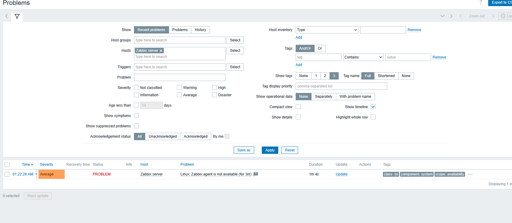
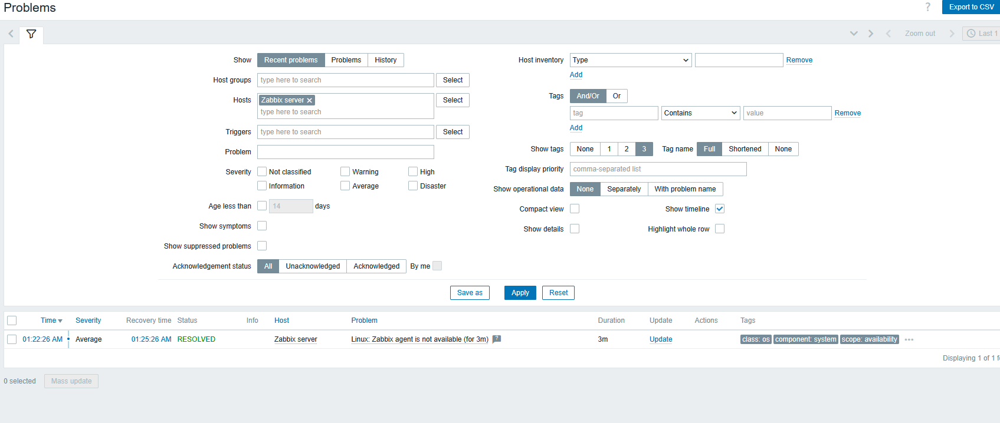

# Monitoramento com Zabbix e Grafana em Docker

Ambiente de monitoramento completo, subido com um único comando via Docker Compose. Reproduz o fluxo de um NOC: coleta de métricas, detecção de problemas e visualização em dashboards.

## O que este projeto sobe

| Serviço | Função | Porta |
|---|---|---|
| **MySQL 8.0** | Banco de dados do Zabbix | interna |
| **Zabbix Server** | Coleta e processa métricas, avalia gatilhos (triggers) | 10051 |
| **Zabbix Web** | Interface web de administração | 8080 |
| **Zabbix Agent** | Agente que reporta as métricas da máquina monitorada | interna |
| **Grafana** | Dashboards, com o plugin oficial do Zabbix | 3000 |

```
[Zabbix Agent] --métricas--> [Zabbix Server] <--> [MySQL]
                                   ^
                      [Zabbix Web]-+      [Grafana] --API--> [Zabbix Web]
```

## Boas práticas aplicadas

- Senhas fora do código: variáveis em `.env`, que está no `.gitignore`
- Versões das imagens fixadas, para o ambiente ser reproduzível
- `healthcheck` no banco e `depends_on` com condição, para o Zabbix só subir depois que o MySQL estiver pronto
- Dados persistidos em volumes, que sobrevivem à reinicialização dos containers
- Rede Docker dedicada para os serviços

## Pré-requisitos

- [Docker Desktop](https://www.docker.com/products/docker-desktop/) (no Windows, com WSL 2)

## Como usar

```bash
# 1. Variáveis (troque as três senhas)
cp .env.example .env

# 2. Subir
docker compose up -d

# 3. Acompanhar a inicialização (a primeira vez leva alguns minutos)
docker compose logs -f zabbix-server
```

Acessos:
- Zabbix: http://localhost:8080 (usuário `Admin`, senha inicial `zabbix`; **troque a senha no primeiro acesso**)
- Grafana: http://localhost:3000 (usuário `admin`, senha definida no `.env`)

## Configuração inicial

**1. Apontar o Zabbix para o agente**
O host "Zabbix server" já vem cadastrado e aponta para `127.0.0.1`. Como o agente roda em outro container, ajuste:
`Coleta de dados > Hosts > Zabbix server > Interfaces`, com conexão por **DNS**, nome `zabbix-agent`, porta `10050`. Depois de alguns minutos, o indicador de disponibilidade (ZBX) fica verde.

**2. Conectar o Grafana ao Zabbix**
- Em `Administration > Plugins`, ative o **Zabbix** (plugin `alexanderzobnin-zabbix-app`).
- Em `Connections > Data sources`, adicione a fonte de dados **Zabbix**:
  - URL: `http://zabbix-web:8080/api_jsonrpc.php`
  - Usuário e senha do Zabbix
- Crie um dashboard com CPU, memória e disco do host monitorado.

## Demonstração: simulando um incidente

Para ver o fluxo de detecção de um problema, como no NOC:

```bash
docker compose stop zabbix-agent
```

Depois de alguns minutos, o Zabbix aciona um problema de agente indisponível. Veja em `Monitoramento > Problemas`. Para resolver:

```bash
docker compose start zabbix-agent
```

## Comandos úteis

```bash
docker compose ps          # estado dos serviços
docker compose logs <svc>  # logs de um serviço
docker compose down        # para e remove os containers (mantém os dados)
docker compose down -v     # remove também os volumes (apaga os dados)
```


## Solução de problemas

**Erro "React error #130" ao configurar o plugin do Zabbix no Grafana**
Causa: incompatibilidade entre a versão do plugin e a do Grafana.
Solução: atualizar a imagem do Grafana e fixar as versões do Grafana e do plugin no `docker-compose.yml`.

**Indicador ZBX vermelho no host "Zabbix server"**
Causa: o host aponta para `127.0.0.1`, mas o agente roda em outro container.
Solução: configurar a interface por DNS, com o nome `zabbix-agent`, porta `10050`.

## Próximos passos

- [ ] Adicionar um segundo host monitorado (por exemplo, uma VM Linux)
- [ ] Criar gatilhos e alertas por e-mail ou Telegram
- [ ] Provisionar a fonte de dados e os dashboards do Grafana via arquivos
- [ ] Monitorar a instância EC2 do projeto de Terraform

## Resultados

Aqui estão as evidências da simulação do incidente (detecção e resolução):




